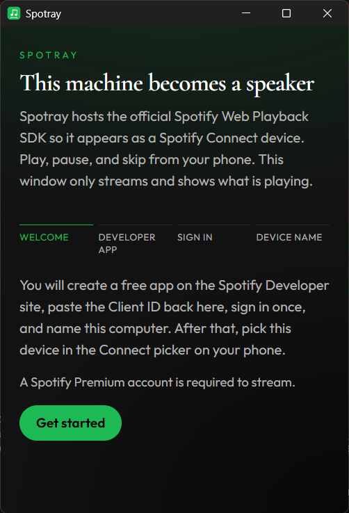
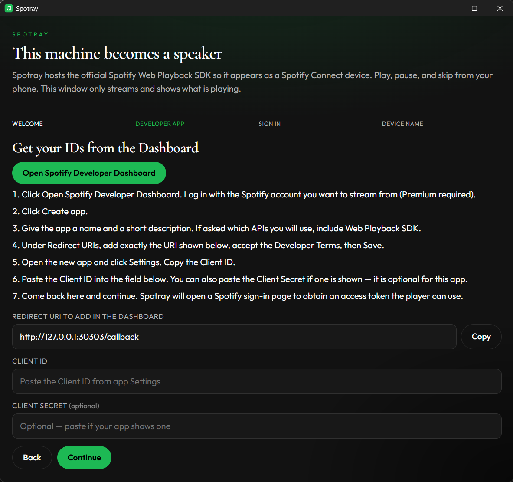
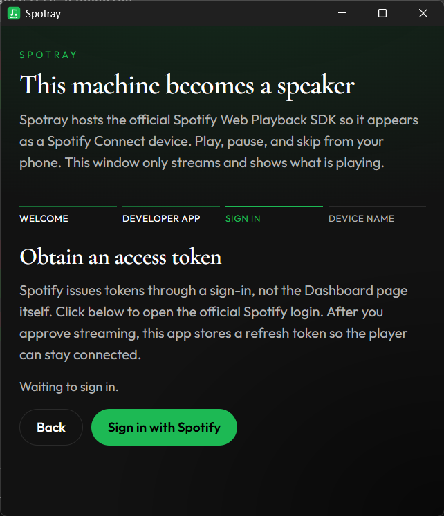
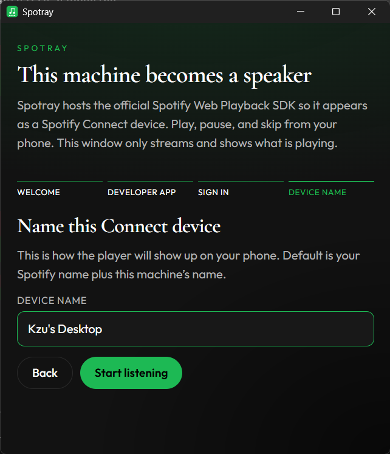
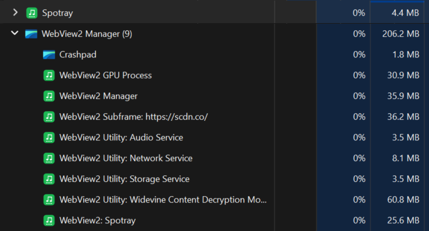
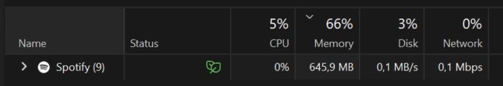

<p align="center">
  
</p>

# Spotray

A tray-resident Tauri app that hosts the official [Spotify Web Playback SDK](https://developer.spotify.com/documentation/web-playback-sdk) so this computer appears as a **Spotify Connect** device. Control playback from your phone. Spotray only streams and shows cover art plus metadata (required by Spotify’s license). Because there is no desktop UI to keep around, it typically uses **less than a third of the memory** of the full Spotify app (~205 MB vs ~650 MB).

## Requirements

- Spotify Premium
- Windows with WebView2 (for Widevine / encrypted streams)
- A free app on the [Spotify Developer Dashboard](https://developer.spotify.com/dashboard)

## Run

```bash
npm install
npm test
cargo test --manifest-path src-tauri/Cargo.toml
npm run tauri dev
```

On first launch a wizard walks through creating a Dashboard app, pasting the Client ID, signing in (PKCE) so the SDK can receive an access token, and naming the device (`{display name}'s {machine name}`).

| Welcome | Developer app |
| :---: | :---: |
|  |  |
| **Sign in** | **Device name** |
|  |  |

The window minimizes / closes to the tray. Tray menu: **Log out**, **Show**, **Exit**.

## Install

After the first WinGet PR is merged:

```powershell
winget install Kzu.Spotray
```

Or download the NSIS/MSI installer from [Releases](https://github.com/kzu/spotray/releases).

## Release

Bump `version` in `package.json`, `src-tauri/Cargo.toml`, and `src-tauri/tauri.conf.json`, then:

```bash
git tag v0.1.0
git push origin v0.1.0
```

That runs [`.github/workflows/release.yml`](.github/workflows/release.yml): tests, Windows NSIS + MSI, a GitHub Release, then a PR to [microsoft/winget-pkgs](https://github.com/microsoft/winget-pkgs) as `Kzu.Spotray`. Tags with a hyphen (for example `v0.1.0-rc.1`) are published as GitHub prereleases and skip WinGet.

One-time setup:

1. Fork [microsoft/winget-pkgs](https://github.com/microsoft/winget-pkgs) on the same GitHub account as this repo.
2. Create a **classic** PAT with `public_repo` (fine-grained tokens cannot open the WinGet PR).
3. Add it as repo secret `WINGET_TOKEN`.

WinGet Releaser can only *update* an existing identifier. After the first GitHub Release exists, bootstrap once:

```powershell
winget install wingetcreate
wingetcreate new https://github.com/kzu/spotray/releases/download/v0.1.0/Spotray_0.1.0_x64-setup.exe
```

Accept the defaults, submit, and wait for that PR to merge. Later `v*` tags open the update PR automatically.

| Spotray (~205 MB) | Spotify desktop (~650 MB) |
| :---: | :---: |
|  |  |
